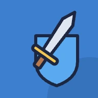
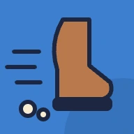
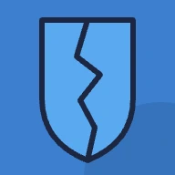
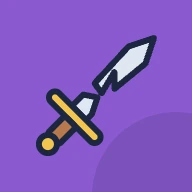
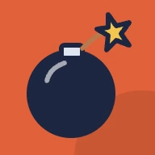

<!-- Generated from data/*.json by `npm run docs`. Edit data in the editor (editor/), not this file. -->

## Active Dice Faces

These dice faces are active and intended to be enabled and implemented in-game.

| Template               | Targeting    | Keywords                              | Image                                                                                       | Notes                        |
| ---------------------- | ------------ | ------------------------------------- | ------------------------------------------------------------------------------------------- | ---------------------------- |
| `blank`                | None         |                                       |                     | Does nothing, cannot be used |
| `dmg`                  | Single Enemy | {damage}                              |                       |                              |
| `block`                | Self         | {block}                               |                    |                              |
| `dmgCantrip`           | Single Enemy | {damage} {cantrip}                 |               |                              |
| `dmgVulnerable`        | Single Enemy | {damage} {exert} {vulnerable 1} |            |                              |
| `dmgBlock`             | Single Enemy | {damage} {selfShield}              |           |                              |
| `blockCantrip`         | Self         | {block} {cantrip}                  |          |                              |
| `poison`               | Single Enemy | {damage} {poison 1}                |                     |                              |
| `dmgWeak`              | Single Enemy | {damage} {weak 1}                  |                    |                              |
| `weak`                 | Single Enemy | {weak 1} {exert}                   |                   | Pips do nothing at baseline  |
| `dmgSingleCast`        | Single Enemy | {singleCast} {damage}              |              |                              |
| `blockSelfBurn`        | Self         | {block} {selfBurn 1}               |      |                              |
| `burnEnemy`            | Single Enemy | {burn 2}                              |                 |                              |
| `dmgExhaust`           | Single Enemy | {damage} {exhaust}                 |         |                              |
| `dmgApplyBurn`         | Single Enemy | {damage} {burn 1}                  |        |                              |
| `blockExhaust`         | Self         | {block} {exhaust}                  |     |                              |
| `dmgDieBlanks`         | Single Enemy | {damage} {dieBlanks}               |            |                              |
| `dmgPerBurn`           | Single Enemy | {damage} {burnDamage}              |          |                              |
| `dmgWhileBurning`      | Single Enemy | {damage} {burnDouble}              |     |                              |
| `blockDieBlanks`       | Self         | {block} {dieBlanks}                |            |                              |
| `dmgAfterExhaust`      | Single Enemy | {damage} {afterExhaust 3}          |    |                              |
| `blockFrenzyThreshold` | Self         | {block} {frenzyThreshold 3}        |     |                              |
| `dmgSpendFrenzy`       | Single Enemy | {damage} {frenzySpend 2}           |             |                              |
| `dmgAllWhileBurning`   | All Enemies  | {damage} {burnDouble}              |  |                              |
| `burnExhaust`          | Single Enemy | {burn 4} {exhaust}                 |          |                              |
| `dmgSelfBurn`          | Single Enemy | {damage} {selfBurn 1}              |         |                              |
| `blockSpendFrenzy`     | Self         | {block} {frenzySpend 2}            |       |                              |
| `blockAfterExhaust`    | Self         | {block} {afterExhaust 3}           |          |                              |
| `dmgFrenzyThreshold`   | Single Enemy | {damage} {frenzyThreshold 3}       |         |                              |
| `dmgKitBlanks`         | Single Enemy | {damage} {kitBlanks 6}             |               |                              |
| `dmgSpendAllFrenzy`    | Single Enemy | {damage} {frenzyAll 2}             |    |                              |
| `healExhaust`          | Self         | {heal} {exhaust}                   |              |                              |
| `blockKitBlanks`       | Self         | {block} {kitBlanks 5}              |            |                              |
| `burnAll`              | All Enemies  | {burn 3}                              |                   |                              |
| `blockSelfBurnTwo`     | Self         | {block} {selfBurn 2}               |   |                              |
