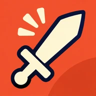
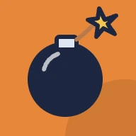

<!-- Generated from data/*.json by `npm run docs`. Edit data in the editor (editor/), not this file. -->

## Active Dice Faces

These dice faces are active and intended to be enabled and implemented in-game.

| Template        | Targeting    | Keywords                              | Image                                                                               | Notes                        |
| --------------- | ------------ | ------------------------------------- | ----------------------------------------------------------------------------------- | ---------------------------- |
| `blank`         | None         |                                       |             | Does nothing, cannot be used |
| `dmg`           | Single Enemy | {damage}                              |               |                              |
| `block`         | Self         | {block}                               |            |                              |
| `dmgCantrip`    | Single Enemy | {damage} {cantrip}                 |       |                              |
| `dmgVulnerable` | Single Enemy | {damage} {exert} {vulnerable 1} |    |                              |
| `dmgBlock`      | Single Enemy | {damage} {selfShield}              |   |                              |
| `blockCantrip`  | Self         | {block} {cantrip}                  |  |                              |
| `poison`        | Single Enemy | {damage} {poison 1}                |             |                              |
| `dmgWeak`       | Single Enemy | {damage} {weak 1}                  |            |                              |
| `weak`          | Single Enemy | {weak 1} {exert}                   |           | Pips do nothing at baseline  |
| `dmgSingleCast` | Single Enemy | {singleCast} {damage}              |      |                              |
